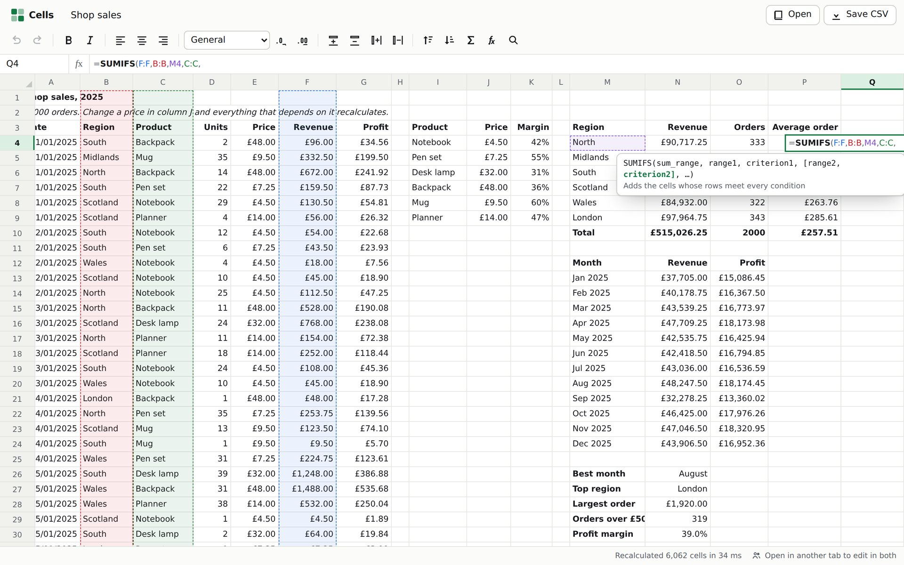
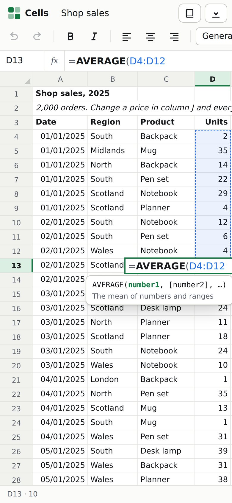

# Cells

**A spreadsheet, written from scratch, in the browser.** 116 functions, formulas that recalculate only what changed, a grid of 1,048,576 rows and 16,384 columns, and editing that works the way hands that know Excel expect. Open it in two tabs and edit in both. Free, no sign-up, and nothing leaves your browser.

**[Open Cells →](https://mohamed-sucule.github.io/Projects/cells/)**

React 19 and TypeScript in strict mode, with no UI, state or spreadsheet libraries: the formula engine, the dependency graph and the grid are all written here.





## What you can do

- **Type formulas** with 116 functions: `SUMIFS`, `XLOOKUP`, `VLOOKUP`, `INDEX`/`MATCH`, `IF`/`IFS`, `TEXT`, `EDATE`, `COUNTIFS`, the statistics, the text functions and the rest, with Excel's rules for blanks, text and errors. Suggestions appear as you type a name, and a box shows which argument the caret is in.
- **Point at cells** while you type: after `=`, an operator or a comma, the arrow keys and the mouse write references in, Shift stretches them into ranges, and every reference gets its own colour in the formula and on the grid.
- **Move about** with the keys you already know: Ctrl+arrows to the edge of the data, Ctrl+Home and Ctrl+End, Page Up and Down, Shift to extend, Enter and Tab walking through a selection, F2 to edit, Ctrl+Enter to fill a selection, Ctrl+D and Ctrl+R.
- **Fill** by dragging the handle: numbers carry their trend on, dates follow the calendar, `Week 1` becomes `Week 2`, and formulas move their references as they go.
- **Copy, cut and paste** inside the sheet and to and from other programs. Pasted formulas shift; a cut moves cells, and every formula that pointed at them follows.
- **Insert and delete rows and columns**, and every formula on the sheet is rewritten to keep pointing at the same cells, or becomes `#REF!` if its cell is gone.
- **Format**: bold, italic, alignment, and number formats from Excel's own codes (`£#,##0.00`, `0.0%`, `dd/mm/yyyy`), with more or fewer decimal places.
- **Sort** a table by any column, keeping its heading row. **Find** anything by its shown value or its formula.
- **Undo everything**, and land back where the change was made.
- **Open and save CSV files.** The sheet is kept in your browser between visits.
- **Edit in two tabs at once**: changes appear in the other tab as you make them, with its cursor shown by name.

Three examples open from the menu: a year of shop orders priced by lookup and summed by region and month, a monthly budget, and 200,000 formulas to see how it copes.

## How it works

**A formula is read once.** A hand-written lexer and a Pratt parser turn `=SUM(A1:A3)*2` into a tree, with Excel's precedence (`-2^2` is 4, because negation binds tighter than `^`) ([`lexer.ts`](src/engine/lexer.ts), [`parser.ts`](src/engine/parser.ts)). Filled-down formulas are the same formula with different cell addresses, so trees are cached by their relative form: `=A1*2` in B1 and `=A2*2` in B2 are both "the cell to my left, times two", and a column of 100,000 such formulas shares one tree.

**Values follow Excel.** Blank cells are 0 in arithmetic and empty in text, `"3" + 1` is 4, errors pass through everything except `IFERROR` and friends, dates are serial numbers with 1900's imaginary 29 February kept so serials match Excel's, and criteria like `">=10"` or `"N*"` work in `SUMIF`, `COUNTIFS` and the rest ([`values.ts`](src/engine/values.ts), [`functions.ts`](src/engine/functions.ts), [`criteria.ts`](src/engine/criteria.ts)). Number formats are an interpreter for Excel's format codes, sections, thousands separators, percentages and all ([`format.ts`](src/engine/format.ts)).

**Only what changed is recalculated.** Each formula's references are indexed: single cells by column and row, tall ranges by the columns they cover and wide ones by their rows, so `SUM(B:B)` is one entry, not a million. When cells change, a breadth-first walk of that index finds everything downstream, and Tarjan's algorithm orders it so each formula comes after what it reads. A group of formulas that read each other is a strongly connected component, so the same pass finds circular references and marks them `#CYCLE!` ([`sheet.ts`](src/engine/sheet.ts)). Both run without recursion, because a chain of 100,000 formulas would overflow the call stack, and both run on typed arrays, because maps keyed by cell turned out to be most of the cost (see below).

**References are rewritten, never re-typed.** Copying, filling, sorting, inserting, deleting and moving all change formulas. Each is a function from one cell address to another, applied to the formula's tokens, so the spacing and case the person typed survive and `$A$1` stays put ([`rewrite.ts`](src/engine/rewrite.ts)). Undoing a row insertion deletes the row and then puts back exactly the cells and formulas it changed.

**A grid taller than the browser allows.** 1,048,576 rows of 24 pixels is 25 million pixels, and browsers will not scroll an element that tall (Firefox stops near 17.9 million). So the scrollable area is capped at 8 million pixels and the position is scaled; the wheel and the keyboard are divided by the same scale, so a notch of the wheel still moves the sheet by its usual amount ([`geometry.ts`](src/grid/geometry.ts)). Only the cells in view are in the page, positioned in a layer that stays put while an empty spacer gives the scroller its size. Text that does not fit runs on over empty cells, and a number that does not fit shows `###`, as in every spreadsheet ([`Grid.tsx`](src/grid/Grid.tsx)).

**A grid a screen reader can use.** It is one focusable `role="grid"` with `aria-rowcount` of 1,048,577 and `aria-activedescendant` naming the active cell, which is always in the page, even scrolled out of view, so a screen reader follows the cursor anywhere. Each cell announces its address, value and formula. The menus follow the WAI-ARIA menu pattern, the suggestions the combobox pattern, and status messages say what each action did ("Undid typing in J4", "R8 shows #CYCLE!: it depends on its own result").

**Touch is not a small mouse.** With a mouse, pressing selects and dragging extends. On a phone, dragging has to scroll, so a tap selects, a second tap edits, and the editor is focused inside the tap itself, because phones only open the keyboard for a focus that happens during the person's own gesture. The fill handle grows to thumb size.

**Two tabs, no server.** Tabs talk over a `BroadcastChannel`. Every cell carries a Lamport timestamp and the tab's id, and a change only lands if it is newer than what the cell has, so whatever order messages arrive in, every tab ends up with the same sheet ([`sync.ts`](src/app/sync.ts)). Inserting a row moves every cell below it, which no per-cell rule can merge, so that tab sends the whole sheet. The workbook is saved in IndexedDB, quietly doing nothing where storage is off ([`persist.ts`](src/app/persist.ts)).

## How fast

Measured with `npm run bench` (Node 22, median of several runs) and in headless Chromium, on the cloud machine this was built on:

|                                                                                                        |        |
| ------------------------------------------------------------------------------------------------------ | -----: |
| Open the 200,000-formula example: parse, index and calculate everything                                | 0.93 s |
| Change the cell at the start of a 100,000-formula chain: 200,001 cells recalculated                    | 133 ms |
| Change the end of that chain: the 3 formulas downstream, a SUM and a COUNT of 100,000 cells among them |   7 ms |
| Change one price in Shop sales: 6,043 lookups, sums and totals                                         |  12 ms |
| Insert a row at the top of the 200,000-formula sheet, rewriting every formula                          | 1.26 s |

The first version took 681 ms to recalculate that chain. Profiling showed that evaluating the formulas was a small part of it; most of the time went on maps and sets keyed by cell. A cell key is row × 16,384 + column, which past row 65,536 is too large for V8's small integers, so every map lookup hashed a boxed number and every insertion made garbage. Numbering the cells of each recalculation 0, 1, 2… and running the ordering on typed arrays took it to 393 ms. Keeping a pass's marks on the formulas themselves, and having the dependency index hold cells rather than keys, so that following an edge needs no lookup at all, took it to 133 ms. Walking a column's cells from an array kept in row order, instead of looking each one up, took a change at the end of the chain from 31 ms to 7.

## Tests

```sh
npm run check   # formatting, lint (type-aware, with the React Compiler's rules), types, unit tests
npm run e2e     # Playwright, desktop and phone, against the production build
npm run bench
```

- **209 unit tests** (Vitest) of the engine:
  - the functions against Excel's answers, including its rules for blanks, text and errors;
  - **a property test that recalculation is right**: fast-check makes random sequences of edits (numbers, blanks, and formulas with arithmetic, `SUM`, `COUNT`, `IF` and `IFERROR` over random references), and after every edit each cell must equal what a plain evaluator, recursing from scratch, says it should be, `#CYCLE!` included. The test was checked by breaking the engine on purpose to see it fail;
  - a property test that any sequence of edits undoes exactly;
  - property tests that reference rewriting comes back to where it started, that any insertion or deletion of rows or columns undoes exactly, and that CSV reads back what it writes;
  - a 100,000-formula chain without overflowing the stack, whole-column ranges, volatile functions, shared trees, fill series, CSV and TSV, number formats.
- **16 end-to-end tests** (Playwright) against the production build, 14 with a keyboard and mouse on a desktop and 2 by touch on a phone: a change flowing through lookups and totals with undo and redo; pointing at cells while typing a formula; suggestions and argument hints; errors and circular references explained; going to row 1,048,576 and back with the screen reader's active cell following; the fill handle; cut and paste with formulas following; inserting a row; sorting; the right-click menu; saving and opening CSV; two tabs editing live; keeping the sheet after a reload; tap to select and tap again to edit on a phone, and the layout fitting its screen; and axe with the editor and the menu open.

## Run it

```sh
npm ci                  # at the root of the repository: one lockfile for every app
npm run dev -w cells    # http://localhost:5173
```

The deploy builds it into `/cells/` on the site ([`pages.yml`](../.github/workflows/pages.yml)); its checks run in [`cells.yml`](../.github/workflows/cells.yml).

## Not yet

One sheet per workbook, no charts, no conditional formatting, no merged cells, and no `.xlsx`. Cell references only: no named ranges, no references to other sheets, and no dynamic arrays (`FILTER`, `SORT`, `UNIQUE`), which need cells that spill into their neighbours. Editing in two tabs is last-writer-wins per cell, which is right for a cell but means two people typing into the same cell at the same moment keep one of the two.

## Licence

MIT
