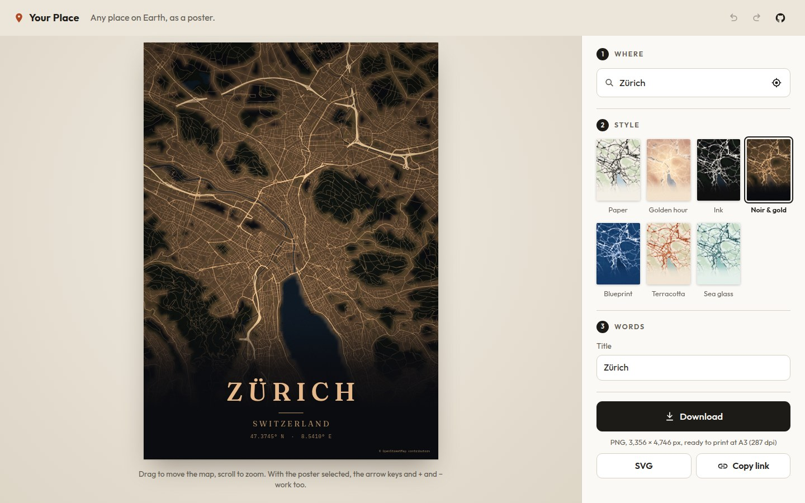
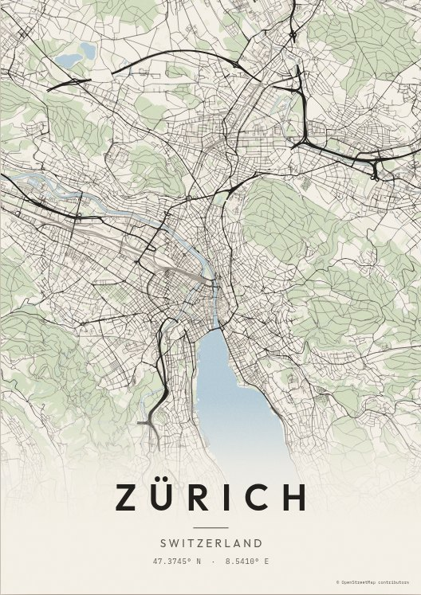
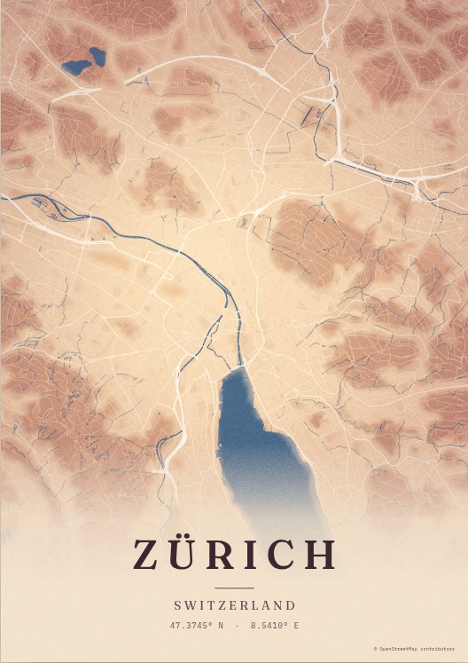
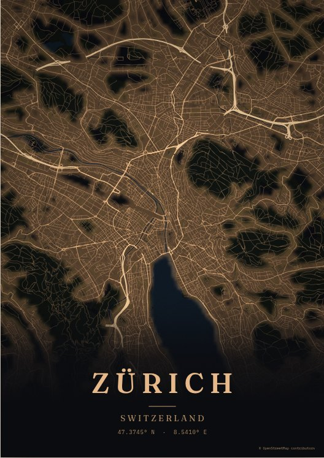
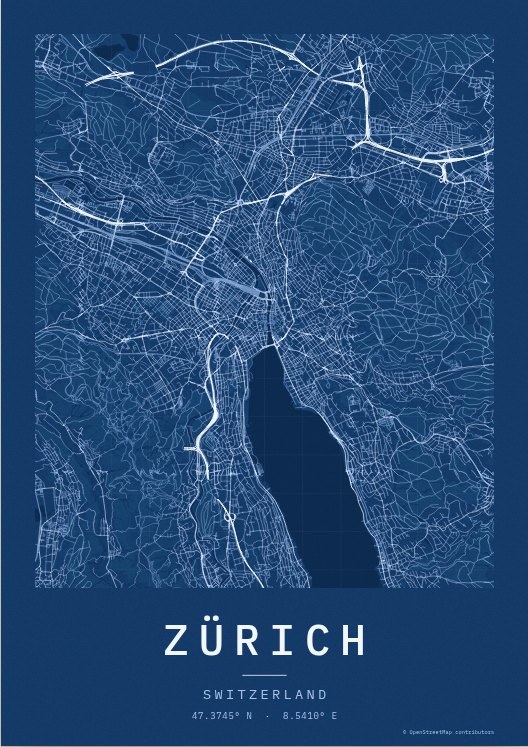

# Your Place

**Any place on Earth, as a poster.** Type a place, pick a style, download a file that is ready to print. Free, no sign-up, and nothing you make leaves your browser.

**[Open Your Place →](https://mohamed-sucule.github.io/Projects/your-place/)**

It hangs in the [gallery of my work](https://mohamed-sucule.github.io/Projects/atlas/) with everything else. Everything else there is plain JavaScript with no build step; this one is React and TypeScript on purpose, because that is what most teams build with.



<p>
  
  
  
  
</p>

It works anywhere on Earth: the map data covers the whole planet, and place search finds cities, streets and addresses everywhere. These examples are Zürich because it's the real OpenStreetMap data the test suite draws from.

## What you can do

- **Find any place**: a city, a street, an address, or wherever you are now. It opens on somewhere near you, guessed from your time zone without asking for your location.
- **Choose a style** from seven. Each thumbnail shows _your_ place in that style, not a stock picture.
- **Frame it** by dragging the map, scrolling or pinching to zoom, or with the arrow keys and + / −.
- **Write on it**: a title, a line below (a country, a date, two names), coordinates, and a choice of three typefaces. Names in any script come out right: Arabic runs right to left with its letters joined, Hindi and Thai keep their vowel signs, and Chinese, Japanese and Korean are spaced like Latin.
- **Pick a size**: A4 to 50 × 70 cm, US sizes, a square for sharing, or a phone wallpaper. Print sizes come out at up to 300 dpi, and the app tells you the real figure.
- **Download** a PNG, an SVG with its fonts embedded, or share straight from your phone.
- **Undo anything**, and **send the link**: the address _is_ the poster, so whoever opens it gets exactly what you made.

## How it works

TypeScript in strict mode, React 19 and Vite, with no UI or state libraries. The map engine is written from scratch on top of a vector-tile parser.

**Map data.** Streets, water, parks and buildings come from [OpenFreeMap](https://openfreemap.org), as vector tiles in the [OpenMapTiles](https://openmaptiles.org) schema: free, with no key, and served from a CDN. Each tile is decoded once. Of its sixteen layers (shops, bus stops and house numbers among them) only what a poster draws is kept: 18 kinds of shape, packed into flat `Int16Array`s and held in a size-bounded cache ([`decode.ts`](src/map/decode.ts), [`source.ts`](src/map/source.ts)).

**The same streets at any size.** A view's zoom is defined for a map 1000 px wide, and the tile zoom depends only on the view, never on the output size. So the 500 px preview, the 84 px thumbnails and the 7000 px print all show exactly the same streets. The rule is at most five tiles across, which keeps a city legible and caps a tall poster at about 50 tiles ([`geo.ts`](src/map/geo.ts)).

**Drawing off the main thread.** Painting runs in a Web Worker on an `OffscreenCanvas`, so typing and dragging never stutter ([`worker.ts`](src/map/worker.ts)).

- Each request names a channel, and a newer request on the same channel cancels the older one as soon as the worker notices.
- Paints take turns by priority: the poster you are looking at comes first, then a download, then the thumbnails ([`engine.ts`](src/map/engine.ts)).
- Browsers that cannot draw in a worker get the same engine on the main thread. Its code is only downloaded for them ([`client.ts`](src/map/client.ts)).

**Dragging that never waits.** Only one paint is in flight at a time, and always for the newest view. Until it arrives, the last picture is re-projected to where it belongs: one scale and one offset, worked out in Web Mercator. The map follows your finger while the words stay put ([`compose.ts`](src/poster/compose.ts), [`PosterPreview.tsx`](src/components/PosterPreview.tsx)).

**One geometry walk, two outputs.** The code that walks the tiles writes to a three-method "pen". A `Path2D` is one pen, for the preview and the PNG. An SVG path builder is another, which rounds to a tenth of a unit and drops repeated points. Effects are rebuilt from SVG's own parts: a gradient for the wash, `feGaussianBlur` for the glow, `feTurbulence` for the paper grain ([`draw.ts`](src/map/draw.ts), [`svg.ts`](src/map/svg.ts)).

**Two performance fixes, found by measuring.** In headless Chromium with software rendering, the first poster took **41.7 s**. It now takes **0.39 s**.

- The view was asking for 88 tiles where 30 show the same streets.
- In Chromium, `Path2D.closePath()` costs time in proportion to the path built so far. Tracing 90,000 building outlines took 85 s with it and 77 ms without. A fill closes its rings anyway, so canvas output skips it, and the SVG keeps it.

**Printing honestly.** Print sizes aim for 300 dpi but stay within 16 million pixels, Safari's canvas ceiling, or 12 million on phones. When that lowers the dpi, the download button says so ([`sizes.ts`](src/poster/sizes.ts)).

**Words in every script.** Titles are letter-spaced by grapheme, using `Intl.Segmenter`, so "Zürich" written with a combining umlaut, or a flag emoji, counts as the letters you see. But spacing letters out only suits some scripts: drawn one letter at a time, Arabic loses its joins and comes out backwards, and Hindi drops its vowel signs. So only Latin, Greek, Cyrillic and East Asian titles are spaced. Everything else is set as one run, which the browser shapes and orders itself. Each line shrinks to fit, and the same measured layout feeds the canvas and the SVG ([`words.ts`](src/poster/words.ts)). Place names are asked for in your browser's language where Photon has it, so "Cairo" reads as Cairo to an English reader; the title stays editable for anyone who wants القاهرة.

**State you can trust.** One reducer describes a poster, and undo/redo wraps it ([`history.ts`](src/state/history.ts)).

- A whole drag is one undo step.
- Typing in one field merges into one step, but not across fields.
- Finding your starting place isn't an edit, so there is nothing to undo back to.
- The URL is validated on the way in: anything malformed falls back to a default, and numbers are clamped ([`url.ts`](src/state/url.ts)).

**Accessible by construction.**

- Place search follows the WAI-ARIA combobox pattern, with suggestions you can arrow through and results announced ([`PlaceSearch.tsx`](src/components/PlaceSearch.tsx)).
- Styles, typefaces and layouts are real radio buttons laid over their visuals.
- The poster is a labelled image that also works from the keyboard.
- Motion is reduced when you ask for it.
- axe runs on every build.

**Credit where it's due.** Every poster carries "© OpenStreetMap contributors", as the data's licence asks.

## Tests

```sh
npm run check              # formatting, lint (type-aware), types, unit tests
npm run fixtures && npm run e2e
```

- **55 unit tests** (Vitest) cover:
  - the Mercator maths;
  - decoding a real Zurich tile;
  - undo and redo;
  - links;
  - reading Photon results;
  - layout, text fitting, and which scripts can be letter-spaced;
  - SVG output.
- **12 end-to-end scenarios** (Playwright), each run on a desktop and a phone, against the production build:
  - drawn from the real OpenStreetMap tiles of Zurich published as [TileServer GL's test data](https://github.com/maptiler/tileserver-gl), and served locally in place of OpenFreeMap;
  - they search, restyle, drag, pinch, zoom, undo, reopen links, download, and check the PNG's pixel size and the SVG's contents;
  - they cut the map service off and check the app recovers, and run axe for accessibility.

The tests have already caught real bugs:

- bounding boxes were fitted with the aspect ratio upside down;
- scroll-to-zoom was never attached, because the canvas didn't exist yet when the listener was;
- a longitude drifted by 10⁻¹³ on every round trip through the URL.

## Run it

```sh
cd your-place
npm ci
npm run dev        # http://localhost:5173
```

Node 22.13 or newer. CI ([`your-place.yml`](../.github/workflows/your-place.yml)) runs the checks and the end-to-end suite on every change to this folder. The site's deploy builds it into `/your-place/`.

## Layout

```
src/map/        the engine: Mercator maths, tiles, decoding, drawing, SVG, the worker
src/poster/     sizes, layout, words, putting a poster together, downloads
src/places/     place search (Photon)
src/state/      the poster, undo/redo, links
src/components/ the React interface
tests/          unit tests, end-to-end tests, fixtures
```

## Credits

- Map data © [OpenStreetMap contributors](https://www.openstreetmap.org/copyright), under the ODbL.
- Tiles by [OpenFreeMap](https://openfreemap.org), in the [OpenMapTiles](https://openmaptiles.org) schema.
- Place search by [Photon](https://photon.komoot.io), from Komoot.
- Fonts: Outfit, Fraunces and IBM Plex Mono, under the SIL Open Font License.
- Code under the MIT licence.
