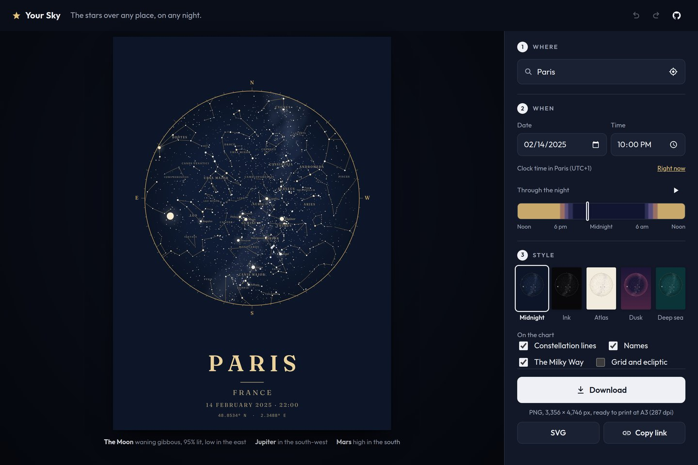
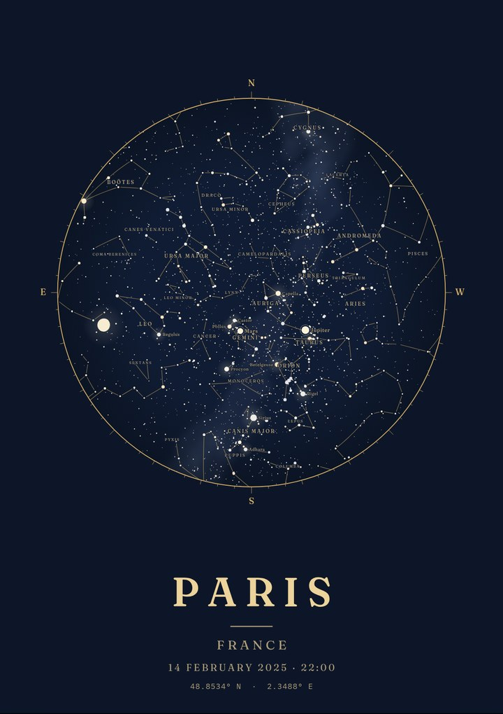
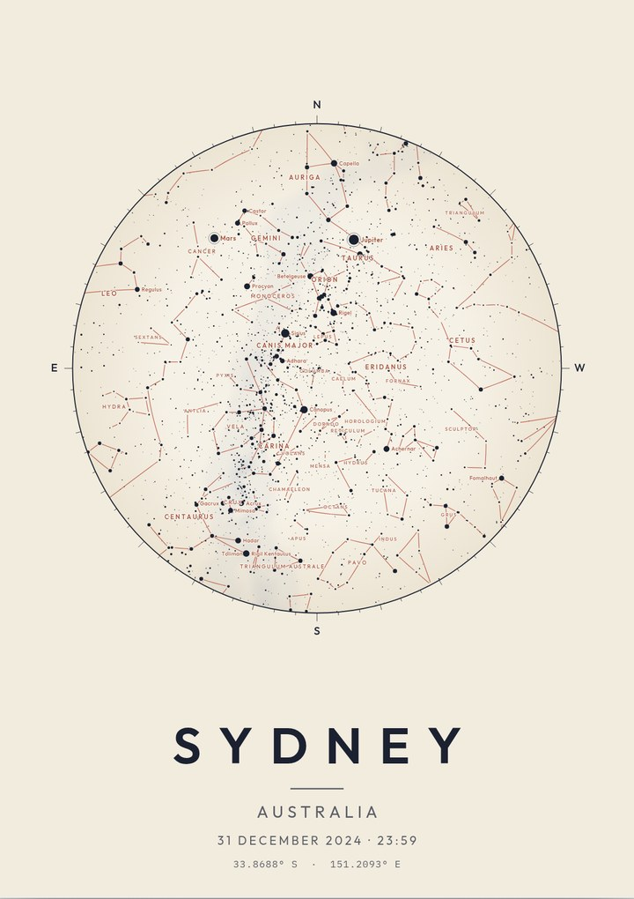
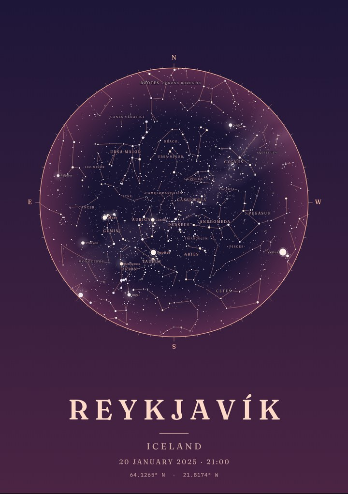
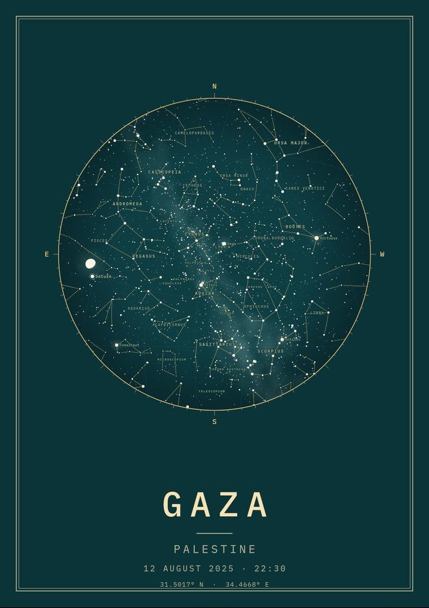

# Your Sky

**The stars over any place, on any night, as a poster.** Pick a place and a moment (a birthday, the night you met, the night someone was born) and get a star chart of exactly what was overhead: the constellations, the Milky Way, the planets where they really were, and the Moon in its real phase. Free, no sign-up, and nothing you make leaves your browser.

**[Open Your Sky →](https://mohamed-sucule.github.io/Projects/your-sky/)**

It sits in [the portfolio's repository](https://github.com/Mohamed-Sucule/Projects) beside its partner, [Your Place](../your-place/), which makes posters of maps. Both are React and TypeScript.



<p>
  
  
  
  
</p>

The charts are real. Over Reykjavík on 20 January 2025, Venus and Saturn sit together low in the west two days after their conjunction, Mars is at opposition in Gemini, and Jupiter is in Taurus. Over Sydney, Orion stands on its head in the north.

## What you can do

- **Find any place**: a city, a town, an address, or wherever you are now. It opens on tonight's sky somewhere near you, guessed from your time zone without asking for your location.
- **Choose the moment**: any date from 1800 to 2200, at any time. The time is the clock time _at the place_: 22:00 in Sydney means 22:00 on a clock in Sydney, in whatever offset Sydney kept that day.
- **Play the night**: a slider runs from noon to noon, shaded with the real daylight, twilight and darkness at the place, and a play button turns the sky through the whole night.
- **Choose a style** from five. Each thumbnail shows _your_ sky in that style.
- **Choose what is drawn**: constellation lines, names, the Milky Way, and a grid with the ecliptic.
- **Write on it**: a title, a line below, the date and time, the coordinates, in one of three typefaces.
- **Pick a size**: A4 to 50 × 70 cm, US sizes, a square, or a phone wallpaper. Wide posters put the chart beside the words.
- **Download** a PNG at up to 300 dpi, an SVG with its fonts embedded, or share from your phone.
- **Undo anything**, and **send the link**: the address _is_ the poster.

Under the poster, the app says what is up in plain words ("The Moon: waning gibbous, 95% lit, low in the east. Jupiter: in the south-west."), and says when the Sun is up and daylight would hide the stars. The same words are the chart's text alternative for screen readers.

## How it works

TypeScript in strict mode, React 19 and Vite, with no UI or state libraries. The positions come from [Astronomy Engine](https://github.com/cosinekitty/astronomy); the projection, the chart, the Milky Way and both renderers are written here.

**The stars, once.** The 5,044 stars a person can see (to magnitude 6) are stored as directions in the J2000 equatorial frame, with their brightness and colour ([`catalogue.ts`](src/sky/catalogue.ts)). They barely move against each other in a lifetime. What changes is how that frame sits over an observer, and Astronomy Engine gives that as a single rotation: the Earth's turning, its slow wobble (precession and nutation) and the observer's place on the globe. So turning the whole sky to a new moment is one matrix and 5,044 multiplications. The Sun, the Moon and the five naked-eye planets move, so each gets its own position, seen from the observer's place rather than the Earth's centre ([`astro.ts`](src/sky/astro.ts)).

**A chart that keeps shapes.** The sky is drawn in a stereographic projection centred straight overhead, with the horizon as the edge. It keeps shapes, so a constellation looks as it does in the sky, and it maps circles on the sky to circles on paper, which is why planispheres use it. Charts of the sky are drawn as seen looking up, so east is on the left ([`project.ts`](src/sky/project.ts)). Constellation lines are great-circle arcs, cut into steps of two degrees so they curve as they should, and stopped short of their stars.

**The Moon, turned to the Sun.** The Moon's phase is the Sun–Moon–Earth angle. Its lit side faces along the sky towards the Sun, which on a chart is a direction that depends on where both are, so it is worked out by stepping a hundredth of a radian from the Moon towards the Sun and seeing which way that goes on the chart. The lit part is a half disc and half an ellipse ([`scene.ts`](src/sky/scene.ts), [`paint.ts`](src/sky/paint.ts)).

**The Milky Way as a glow.** Its outline comes in five nested levels of brightness, and the outermost one circles the whole sky, which makes it awkward to fill on a sphere. So [`scripts/data.mjs`](scripts/data.mjs) fills the outlines once, column by column on a 1024 × 512 map of the sky, blurs them into a glow, and writes a 34 KB greyscale PNG with its own small encoder. To draw it, each pixel of the chart is turned back into a direction in the sky and looked up in the map ([`milkyway.ts`](src/sky/milkyway.ts)). That is the slow part of a chart, so it is worked out at a few hundred pixels across and scaled up smoothly, coarser while the night is playing, and kept until the sky or the style changes.

**Time at the place.** The time zone comes from the coordinates ([tz-lookup](https://github.com/photostructure/tz-lookup)), and the offset from the browser's own copy of the time zone database through `Intl`, so historical offsets are right too: Britain kept summer time all year from 1968 to 1971, and the tests check it. Twice a year a clock time is not one answer: when clocks jump forward, 02:30 never happens and is read as 03:30; when they fall back, 02:30 happens twice and the first is taken, as Temporal's "compatible" rule does ([`time.ts`](src/sky/time.ts)).

**One scene, two outputs.** One pass turns the sky into a scene in pixels: where each star is and how big, the lines, the Moon, the planets, and which labels fit. Labels go on in order of importance (planets, then the famous constellations, the bright stars, and the rest), each only if it is inside the horizon and clear of every label before it. The canvas and the SVG are both drawn from that scene, so they always agree ([`svg.ts`](src/sky/svg.ts)).

**Drawing fast enough to play.** While the night plays, each frame costs about 11 ms of JavaScript, measured in headless Chromium: 1.2 ms for the scene, 4.1 ms for the Milky Way at 220 pixels, 4.8 ms to draw the chart and 0.8 ms for the words. Stars are drawn as one path per colour, and the faintest ones share one alpha, so 2,500 stars take a handful of fills. The preview draws at most once a frame however fast the poster changes, and the style thumbnails wait until the sky stops moving.

**State you can trust.** One reducer describes a poster, and undo/redo wraps it ([`history.ts`](../packages/poster-kit/src/history.ts)). A sweep of the slider, by finger or by arrow keys, is one undo step. Moving the sky to a new place moves the place's name and country with it, but never a title you wrote yourself. The URL is validated on the way in ([`url.ts`](src/state/url.ts)).

**Accessible by construction.** Place search follows the WAI-ARIA combobox pattern. Styles, typefaces and layouts are real radio buttons. The slider says the time and day it stands for ("01:30, Saturday 15 February"). The chart's text alternative is worked out from the sky. Playing the night moves in steps when you ask for reduced motion. axe runs on every build.

## Tests

```sh
npm run check   # formatting, lint (type-aware), types, unit tests
npm run e2e
```

- **69 unit tests** (Vitest), 17 of them in [poster-kit](../packages/poster-kit/), the code it shares with Your Place, check the sky against facts:
  - Polaris stands as high as the observer is far north, at four latitudes;
  - the noon Sun at the June solstice in London is at 90° − latitude + 23.4°;
  - the stars come back to the same place after a sidereal day, not a solar one;
  - the full moon of 25 January 2024 is full, and the new moon of 9 February 2024 is new;
  - a first-quarter Moon in the afternoon turns its lit side to the Sun;
  - the Milky Way map is brightest towards the centre of the galaxy and empty at its poles;
  - Jupiter was beside Aldebaran in February 2025;
  - time zones, skipped and doubled clock times, Nepal's +5:45 and the Chatham Islands' +13:45;
  - undo and redo, links, layouts at every size, label placement, SVG output.
- **12 end-to-end scenarios** (Playwright), each run on a desktop and a phone against the production build: the first sky near the visitor, searching, clock time at the place, keeping your own title, the slider by keyboard with one undo, playing and pausing the night, the description and the daylight note, styles, reopening a link, the PNG's size, the SVG's contents, place search going down, and axe.

## Run it

```sh
npm ci                     # at the root of the repository: one lockfile for both apps
npm run dev -w your-sky    # http://localhost:5173
npm run data -w your-sky   # only to rebuild src/sky/data from d3-celestial
```

Node 22.13 or newer. Your Sky and Your Place are npm workspaces, with the code they share in [`packages/poster-kit`](../packages/poster-kit/). CI ([`your-sky.yml`](../.github/workflows/your-sky.yml)) runs the checks and the end-to-end suite whenever this folder, the shared package or the dependencies change. The site's deploy builds it into `/your-sky/`.

## Layout

```
src/sky/        the sky: positions, time zones, projection, scene, Milky Way, canvas and SVG
src/sky/data/   the stars, constellations and Milky Way, built by scripts/data.mjs
src/poster/     layout, words, putting a poster together, downloads
src/state/      the poster and its links
src/components/ the React interface
tests/          unit tests, end-to-end tests, fixtures

../packages/poster-kit/   shared with Your Place: undo/redo, sizes, fonts, place search, icons
```

## Credits

- Stars from XHIP, the extended Hipparcos compilation (Anderson & Francis, 2012); constellation lines and names from the IAU; the Milky Way outline by Jose R. Vieira. All by way of [d3-celestial](https://github.com/ofrohn/d3-celestial) © 2015 Olaf Frohn, under the BSD 3-Clause licence.
- Positions of the Sun, Moon and planets by [Astronomy Engine](https://github.com/cosinekitty/astronomy), under the MIT licence.
- Time zones by [tz-lookup](https://github.com/photostructure/tz-lookup), under CC0.
- Place search by [Photon](https://photon.komoot.io), from Komoot, with data © [OpenStreetMap contributors](https://www.openstreetmap.org/copyright).
- Fonts: Outfit, Fraunces and IBM Plex Mono, under the SIL Open Font License.
- Code under the MIT licence.
